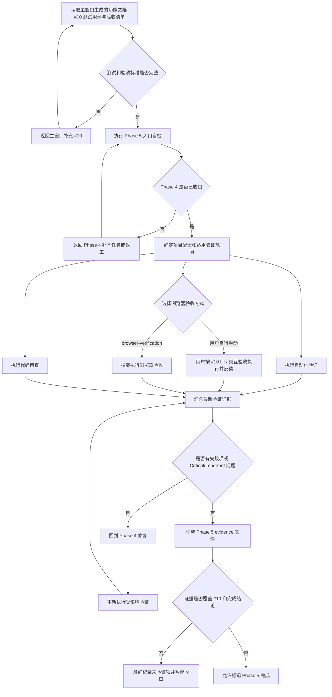

# Phase 5：测试验收

用于根据已确认的功能技术文档执行验证、收集证据、处理返工并决定是否允许收口。

## 1. 职责边界

- 本文件负责验收流程、验证范围、证据记录和收口规则。
- 具体业务验收标准由主窗口生成并确认的功能技术文档提供。
- `verification-before-completion` 负责通用验收标准和最终完成声明门禁，本文件只补充 Phase 5 的执行规则。

## 2. 验收输入

执行 Phase 5 前，只读取主窗口已经生成并确认的功能技术文档 `# 10 测试用例与验收清单`。

- `# 10` 是本次自动化验证和 UI / 交互验收的唯一测试输入。
- `# 10` 定义范围，并提供设计节点/参考图、已确认变更和业务预期的资源定位；允许按这些引用读取原始证据，不因此扩大范围。引用或预期缺失时返回主窗口补齐。
- 不重复读取功能文档的其他章节；其内容已在主窗口生成 `# 10` 时完成整理。
- 若 `# 10` 缺少测试范围、用例、入口、环境或结果记录方式，返回主窗口补充后再开始验收。
- 不得在 Phase 5 临时猜测、扩展或改变 `# 10` 中未确认的验证范围。

## 3. 验收流程



## 4. Phase 5 入口自检

进入测试验收前必须确认 Phase 4 已收口，任一不满足则回到 Phase 4 补齐：

- `spec/` 下所有计划或子任务规格均已有对应执行产物。
- 所有执行方式共用 `tasks.json`；其中不存在 `pending`、`running`、`failed` 或 `rework_requested` 任务。
- 所有已完成任务都已由主 Agent 审查，通过项应标记为 `reviewed`。
- 如存在 `reworks/`，当前返工必须已完成并覆盖原 `resultFile`。
- `results/` 中的执行报告能对应到每个 `spec/*.md`。
- Phase 4 没有遗留的新增范围、接口契约或验收标准变更。

## 5. 执行验证

### 5.1 自动化验证

根据项目 `package.json`、本次改动范围和功能技术文档 `# 10` 中的自动化测试项确定需要执行的自动化验证命令。

- 使用项目实际包管理器和已有 scripts，不混用包管理器。
- 没有固定脚本时，才使用框架通用命令。
- 仅执行与项目配置和改动范围相关的检查，不固定要求测试、类型检查、lint 或构建全部执行。
- 命令执行、输出核对、验证范围判断和结果表述遵循 `verification-before-completion` 技能。
- 将实际命令、选择理由、结果和证据写入本阶段的 evidence 文件。

常见命令仅作示例，必须按项目实际调整：

```bash
<pm> test src/pages/page-name/ -- --coverage
<pm> typecheck
<pm> exec tsc --noEmit
<pm> lint
<pm> build
```

### 5.2 浏览器验收方式

浏览器验收覆盖功能技术文档 `# 10` 中适用的 UI / 交互验收和 E2E 测试项。开始前先向用户展示两种方式并等待选择，**不得在用户选择前启动 dev server、打开浏览器或执行任何浏览器操作**。

环境可被 AI 访问时优先使用方式 B；需要业务人员确认或 AI 无法访问环境时使用方式 A。

#### 🚫 禁止启动 dev server

**AI 不得自行启动 dev server。** 用户通常已自行启动开发服务；即使用户未启动，也只提示用户需要启动，不得代为执行 `npm run dev` 或类似命令。原因：

- dev server 端口、代理、环境变量等由用户控制，AI 无法确定正确配置。
- 多个 dev server 同时运行会端口冲突。
- 用户可能通过 VPN、代理或非标准方式访问，AI 不具备这些上下文。

#### 方式 A：用户自行手动验收

用户按照功能技术文档 `# 10 UI / 交互验收` 和 `# 10 E2E 测试` 执行验收，并反馈：

- 通过或不通过。
- UI / 交互验收项和 E2E 测试项的实际结果。
- 问题截图和复现步骤。
- 设备、浏览器和屏幕尺寸。
- 未验证项和阻塞原因。

主窗口将用户反馈整理到 Phase 5 evidence 文件。用户无法访问环境或无法提供有效证据时，不能直接记录为通过。

#### 方式 B：由 AI 使用 `browser-verification` 技能验收

由 AI 使用 `browser-verification` 和 `lm-browser` 执行 DOM 采集、视觉对比和交互验收，并覆盖 `# 10 E2E 测试` 中可在浏览器完成的业务流程。用户负责提供目标 URL 和访问权限。lm-browser 当前没有网络请求和控制台采集工具；若 `# 10` 要求这类验证且没有经确认的可用方式，必须记录为未验证/阻塞，不能声称通过。

##### 页面来源选择

开始前先确认页面来源（二选一）；用户已指定或已确认时沿用，不重复询问：

| 来源 | 行为 |
|------|------|
| **A) 从 Chrome 已有标签页捕获** | `connect_browsers` → `list_pages`，按完整 URL 精确匹配并记录实例与全局索引；命中后等待稳定、回顶并采集截图/DOM。不为定位目标而导航或新开页。 |
| **B) 新开标签页捕获** | 仅用户明确选择 B 后调用 `open_browser_page`；等待稳定、确认实际 URL/登录态、回顶后采集，不能继承旧页验收结论。 |

> 不得在用户未确认选择前假定来源。选项 A 优先：用户通常已自行打开页面，新开 tab 可能因缺少登录态/cookie 导致白屏或 401。

##### FA MCP 页面匹配规则

先枚举再定位，每次采集后复核完整 URL 与实际业务状态：

- 记录 `browserId`、`browserLabel`、完整 URL 和全局 `page_index`；不能只匹配 path 或标题，遗漏 hash 路由及关键 query。
- 多个目标匹配时按用户指定实例、页面和状态选择；仍有歧义就询问，不任选其一。
- 索引失效时重新 `list_pages`；必要时重新连接，不递增索引逐页抓 DOM。连接成功但列表为空，只能说明当前会话没有可读取页面。
- 目标未命中、列表为空或工具不可用时记录 `blocked`，提示用户在可读实例打开目标页后重新枚举；不得自动新开、导航、切换工具或宣称用户未打开浏览器。不回传无关页面 URL 或 DOM。

##### Figma 设计稿还原对比

依据 `# 10` 中已确认的设计资源，使用 `visual-workflow` 的 `verification` 模式执行视觉对比；模式中的视觉标准和逐模块记录格式是唯一方法来源。本文件只规定 Phase 5 范围、浏览器验收选择、证据记录和收口门禁，不重复视觉判断规则。实际页面采集仍通过 `browser-verification` 完成。

##### 业务流程与交互对比

业务预期来自已确认的 `# 10`，不是 Figma 图像或未确认的节点属性。每项记录前置状态、操作、预期结果、实际结果、操作前后证据及结论。

- 按范围覆盖入口参数、主/子 Tab、搜索筛选分页、弹层打开关闭、数据刷新、权限、空态和失败重试，不临时扩展范围。
- 先按风险分类，仅执行已授权操作。保存、提交、删除等未授权时只记录为未验证，不为清空队列执行写操作。
- 同一功能多个入口应验证可观察结果是否一致，例如都打开相同工具面板；仅按钮存在、组件被复用或 setter 被调用都不是业务通过证据。
- 通过截图、DOM、实际 route 及可用的操作后状态复核结果。接口与控制台能力不可用时单列未验证，不从页面正常推断请求正确。
- 独立记录本节结果。设计通过不能代替业务通过；出现需求缺项回主窗口补 `# 10`，修复回 Phase 4 后重新验收。

推荐由独立验收子窗口执行，主窗口应：

1. 将 `# 10 UI / 交互验收` 的入口、验收项和环境要求挂载到验收任务，并依据 `# 10` 中的单元测试、组件测试和 E2E 测试项确认自动化验证范围。
2. 等待验收任务完成，读取其 `resultFile`，只提取环境、截图、通过项、失败项和阻塞原因。
3. 如有失败项，提取失败证据作为返工原因，在 Phase 4 生成自包含返工文档。
4. 修复完成并覆盖原 `resultFile` 后，重新执行受影响验收。

验收子窗口不得修改业务代码、启动或停止服务，也不得宣布 Phase 5 完成。结果文件建议为：

```text
docs/design/YYYY-MM-DD-<topic>-design/results/05-browser-verification-result.md
```

视觉任务优先复用验收子窗口生成的 `assets/screenshots/` 和验收结论；主窗口只在现有证据不足时读取关键截图，不重新获取或完整分析原始设计资源。

### 5.3 代码审查

- 按 `requesting-code-review` 技能执行代码审查，不把代理报告、VCS diff 或已有测试结果单独当作审查通过证据。
- Critical / Important 问题必须修复，并重新执行受影响验证和 Delta Review。
- Minor 问题记录处理状态，不得将未处理的 Minor 误报为“无问题”。

## 6. 证据记录

只在 Phase 5 生成：

```text
docs/design/YYYY-MM-DD-<topic>-design/evidence/phase5-verification.md
```

Phase 4 在所有执行方式下都维护 `tasks.json` 和各任务 `resultFile`；返工时按需生成 `reworks/`。Phase 5 生成本节指定的 evidence 文件，并记录 `# 10` 中适用测试和验收内容的实际结果，不得只写“页面正常”。

```md
# Phase 5 验证证据

## 验收依据

- 来源：功能技术文档 `# 10 测试用例与验收清单`
- 验收范围：...

## 自动化验证

| 命令 | 选择理由 | 结果 | 退出码 | 验证范围 | 关键输出 |
|------|----------|------|--------|----------|----------|
| `...` | `# 10` 中的自动化测试要求 | 通过 / 失败 / 未执行 / 不适用 | ... | ... | ... |

## 手动验收

### 设计还原对比

| 模块 / 属性 | 设计依据及预期 | 实际观察 / 测量 | 证据 | 结果 |
| --- | --- | --- | --- | --- |
| `# 10` 中的视觉验收项 | 节点 / 参考图 / 已确认变更 | 未测量值保留未知 | 截图区域及可用 DOM / 布局证据 | 通过 / 失败 / 未验证 / 阻塞 / 不适用 |

- 整页模块清单及未完成模块：...
- 状态可比性（记录、Tab、视口、缩放、DPR、滚动位置）：...
- 模块间回归（共享边界、间距、底栏、安全区、遮挡）：...

### 业务流程对比

| 验收项 | 前置状态 / 操作 | `# 10` 预期结果 | 实际结果 / 操作前后证据 | 结果 |
| --- | --- | --- | --- | --- |
| 已确认业务步骤 | ... | ... | 截图 / DOM / route / 可用状态证据 | 通过 / 失败 / 未验证 / 阻塞 / 不适用 |

- 入口：...
- 环境：...
- 验收方式：用户自行手动 / `browser-verification` 技能
- 浏览器实例：`browserId` / `browserLabel`：...
- 目标页面：完整 URL 是否命中、全局 `page_index`：...
- 截图证据：lm-browser 返回的 `screenshotPath`：...
- 网络 / 控制台验收：通过 / 失败 / 未验证 / 阻塞；说明证据来源或未覆盖原因：...
- 未验证项：...
- 阻塞原因：...

## 代码审查

- 审查方式：...
- Critical：...
- Important：...
- Minor：...
- 处理结果：...

## 收口结论

- 结论范围：...
- 设计还原结果：...
- 业务流程结果：...
- 证据是否覆盖 `# 10` 和完成结论：是 / 否
- 最终状态：通过 / 阻塞 / 部分完成
```

## 7. 返工与收口

- 验收失败：回到 Phase 4 修复，再重新执行受影响的 Phase 5 验证。
- Critical / Important 审查问题：修复后重新验收和审查。
- 只验证了部分范围时，只报告已验证部分，不得宣称整体完成。
- Phase 5 的完成声明必须遵循 `verification-before-completion` 的验收标准和验证门控；本阶段证据不足时不得标记完成。

## 8. 常见反模式与错误

| 反模式 | 为什么错 | 正确做法 |
|--------|---------|---------|
| 假设 `page_index=0` 就是目标页面 | Chrome 有多个 tab，顺序不确定 | 先 `list_pages` 按完整 URL 定位；索引失效重新枚举，不逐页抓 DOM |
| Figma px 值直接当 CSS px 用 | Figma 750px 设计稿需要按项目约定转换 | 先查看同页面其他组件的 CSS 确认转换比例（常见 ÷2） |
| 凭印象盲改样式，不对照 FA MCP + Figma | 看起来差不多 ≠ 真的对齐 | 逐层对比：结构→文案→间距→颜色→字体→圆角→交互 |
| 只看截图不读 DOM | 截图看不清间距、字重、className | `inspect_dom` + 截图双重证据 |
| 多次调用 `inspect_dom` 但从不校验 URL | 可能一直在分析错误页面 | 每次调用后第一行输出 URL，确认匹配后再继续 |
| 用 VS Code 内置浏览器代替 Chrome 远程调试 | FA MCP 无法接入 VS Code 浏览器 | 提示用户在 Chrome 中打开目标 URL，并确认 Chrome 已启用远程调试 |
| Figma NODES 只看顶层 FRAME | 内部元素细节（gap/padding/颜色）在子节点 | 递归遍历 NODES 树提取完整设计参数 |
