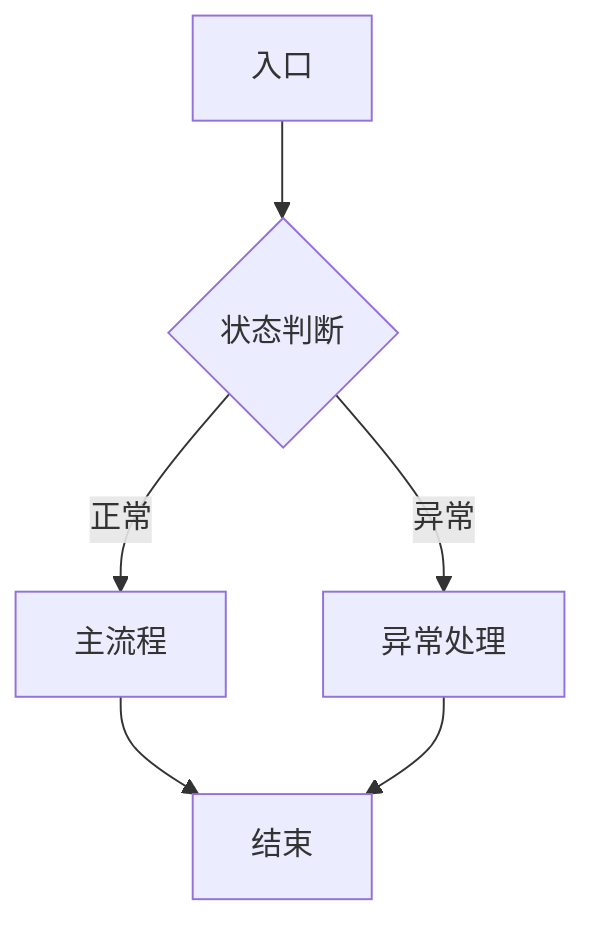
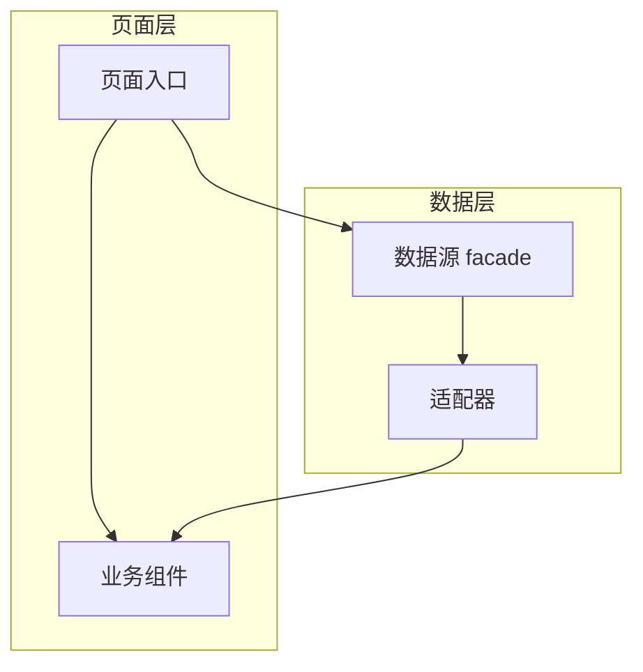
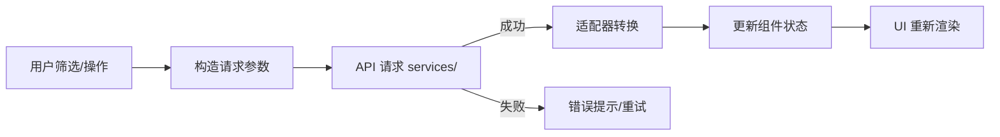

| **文档编号**：     |                             |
| ------------------ | --------------------------- |
| **需求名称**：     | {需求名称}                  |
| **需求ID**：       |                             |
| **前端 Owner**：   | {姓名}                      |
| **文档状态**：     | {起草中/评审中/已定稿}      |
| **最后更新时间**： |                             |

# 1. 需求概述

## 背景和需求

{从业务角度说明：要解决的业务问题、驱动因素和期望达成的业务目标。不要涉及技术实现和项目技术栈，只描述业务需求}

## 任务拆分

> **填写说明：** 按照页面或功能模块拆分任务清单，每项标注优先级（P0/P1/P2）。

- {页面/模块A}
  - {任务A1}（P0）
  - {任务A2}（P1）
- {页面/模块B}
  - {任务B1}（P0）
  - {任务B2}（P1）
- {跨端/通用能力}
  - {任务C1}（P2）

# 2. 技术选型

> **填写说明：** 列出当前功能所需的技术方案，仅包含与本次需求直接相关的技术选型，不要复制项目全量技术栈。

| 维度 | 方案 | 版本 | 是否新增 | 说明{参考} |
| ---- | ---- | :------: | ✓/✗ | {说明，如：轻量、TS友好}{参考链接} |

# 3. 架构设计

> **填写说明：** 架构图使用 Mermaid 或 Draw.io 绘制，流程图覆盖主流程与异常分支，目录结构仅列本次新增或变更的目录。没有可删除本章节。

## 业务流程图

> 用户操作流程与状态、异常变更，使用 Mermaid flowchart 表达决策分支。



## 技术架构图

> 静态模块依赖与分层关系，不展示运行时数据流转。使用 Mermaid graph 分组表达层级。



## 目录结构

> 按项目分组，仅列出本次需求新增或变更的目录和文件，标注 `[新增]` / `[改动]` / `[不动]`。跨项目需求需分别列出各项目的改动。

### {项目A}

> 主力改动项目

```text
src/
├── pages/{page-name}/                 # [新增] 页面目录
│   ├── index.tsx
│   ├── index.module.less
│   ├── types.ts
│   └── components/
│       └── {ComponentName}/index.tsx
├── services/{module}/
│   └── {name}.ts                      # [新增] 接口请求
└── utils/
    └── {name}.ts                      # [改动] 说明改动原因
```

### {项目B}

> 仅一处改动

```text
src/
└── views/{path}/
    └── {file}.ts                      # [改动] 说明改动原因
```

## 路由矩阵

> 列出本次需求涉及的所有页面路由，标注路由路径、页面名称、所属模块和访问入口。

| 路由路径 | 页面名称 | 所属模块 | 说明 |
| -------- | -------- | -------- | ---- |
| `/{path}` | {页面A} | {模块A} | {说明} |
| `/{path}/:id` | {页面B} | {模块A} | {说明} |
| `/{path}` | {页面C} | {模块B} | {说明} |

# 4. 核心技术设计

> **填写说明：** 记录功能中有技术难度或需要专门设计的关键实现，如地图渲染、文件分片上传、实时通信等。没有可删除本章节。

## {技术点名称}

### 技术方案

{方案描述，包含选型依据、核心思路、关键实现逻辑}

# 5. 核心功能模块

## 模块概览

| 模块 | 页面 | 路由 | 负责人 | 说明 |
|------|------|------|--------|------|
| {模块A} | {页面A} | `/{path}` | {姓名} | {说明} |
| {模块A} | {页面B} | `/{path}` | {姓名} | {说明} |
| {模块B} | {页面C} | `/{path}` | {姓名} | {说明} |

---

## {页面名称}

| 属性 | 内容 |
|------|------|
| 路由 | `/{path}` |
| 目标用户 | {角色} |
| 功能概述 | {功能描述} |
| 需求文档 | [{PRD 名称}]({url}) |
| 设计稿 | [{Figma 页面名称}]({url}) |
| 接口文档 | [{Swagger 接口组}]({url}) |
| 相关方案 | [{关联技术方案名称}]({url}) |

### 页面架构

```
{ASCII 页面布局图}
```

### 数据流

> 本页面的运行时数据流向：用户操作 → 构造请求参数 → 接口调用 → 响应适配 → 驱动渲染。区别于 #3 的业务流程图（宏观用户路径）和技术架构图（静态模块依赖）。



### 字段规格

**表单字段**

| 字段名称 | 字段类型 | 是否必填 | 交互规则 |
| -------- | -------- | :------: | -------- |
| {字段1}  | {类型}   |   ✓/✗    | {规则}   |

**列表字段**

| 字段名称 | 字段类型 | 说明 |
| -------- | -------- | ---- |
| {字段1}  | {类型}   | {说明} |

**筛选字段**

| 字段名称 | 字段类型 | 默认值 | 说明 |
| -------- | -------- | ------ | ---- |
| {字段1}  | {类型}   | {默认值} | {说明} |

### 交互规则

| 序号 | 操作   | 行为       |
| :--: | ------ | ---------- |
|  1   | {操作} | {预期行为} |

### 异常逻辑

| 异常场景 | 处理逻辑   |
| -------- | ---------- |
| {场景}   | {处理方式} |

### 组件

**使用矩阵**

| 组件 / 页面       | {页面A} | {页面B} | 类型     | 用途       |
| ----------------- | :-----: | :-----: | -------- | ---------- |
| `{BusinessComp}`  |    ✅    |    -    | 业务组件 | {用途说明} |
| `{CommonComp}`    |    ✅    |    ✅    | 公共组件 | {用途说明} |

**业务组件明细**

| 组件              | 用途       | 关联状态     |
| ----------------- | ---------- | ------------ |
| `{ComponentName}` | {用途说明} | `{stateKey}` |

### hooks

**使用矩阵**

| Hook / 页面       | {页面A} | {页面B} | 来源   | 用途       |
| ----------------- | :-----: | :-----: | ------ | ---------- |
| `use{Feature}`    |    ✅    |    -    | 内部   | {用途说明} |
| `use{CommonHook}` |    ✅    |    ✅    | 公共   | {用途说明} |

**内部 hooks 明细**

| Hook           | 用途   | 依赖            |
| -------------- | ------ | --------------- |
| `use{Feature}` | {说明} | `{API / Store}` |

### utils

**使用矩阵**

| 函数 / 页面       | {页面A} | {页面B} | 来源   | 用途       |
| ----------------- | :-----: | :-----: | ------ | ---------- |
| `{utilName}()`    |    ✅    |    -    | 内部   | {用途说明} |
| `{commonUtil}()`  |    ✅    |    ✅    | 公共   | {用途说明} |

**内部 utils 明细**

| 函数           | 用途   |
| -------------- | ------ |
| `{utilName}()` | {说明} |

### constants

**使用矩阵**

| 常量 / 页面        | {页面A} | {页面B} | 来源   | 用途       |
| ------------------ | :-----: | :-----: | ------ | ---------- |
| `{CONST_NAME}`     |    ✅    |    -    | 内部   | {用途说明} |
| `{COMMON_CONST}`   |    ✅    |    ✅    | 公共   | {用途说明} |

**内部 constants 明细**

| 常量           | 值        | 说明   |
| -------------- | --------- | ------ |
| `{CONST_NAME}` | `{value}` | {说明} |

### enums

**使用矩阵**

| 枚举 / 页面       | {页面A} | {页面B} | 来源   | 用途       |
| ----------------- | :-----: | :-----: | ------ | ---------- |
| `{ENUM_NAME}`     |    ✅    |    -    | 内部   | {用途说明} |
| `{COMMON_ENUM}`   |    ✅    |    ✅    | 公共   | {用途说明} |

**内部 enums 明细**

| 枚举           | 值        | 说明   |
| -------------- | --------- | ------ |
| `{ENUM_NAME}`  | `{value}` | {说明} |

# 6. 公共依赖

> **填写说明：** 集中列出本次需求涉及的公共（跨模块复用）Store、hooks、utils、constants、enums、UI 样式模块，不重复展开设计细节。没有可删除本章节。

## 公共 store

| Store               | 关键字段          | 使用页面   | 依赖 Store     | 说明         |
| -------------------- | ----------------- | ---------- | -------------- | ------------ |
| `use{Feature}Store`  | `{data}, loading` | {页面列表} | `useAuthStore` | {用途说明}   |

## 公共 hooks

| Hook              | 用途       | 使用页面   | 依赖            |
| ----------------- | ---------- | ---------- | --------------- |
| `use{CommonHook}` | {用途说明} | {页面列表} | `{API / Store}` |

## 公共 utils

| 函数             | 用途       | 使用页面   |
| ---------------- | ---------- | ---------- |
| `{commonUtil}()` | {用途说明} | {页面列表} |

## 公共 constants

| 常量             | 值        | 用途       | 使用页面   |
| ---------------- | --------- | ---------- | ---------- |
| `{COMMON_CONST}` | `{value}` | {用途说明} | {页面列表} |

## 公共 enums

| 枚举             | 值        | 用途       | 使用页面   |
| ---------------- | --------- | ---------- | ---------- |
| `{COMMON_ENUM}`  | `{value}` | {用途说明} | {页面列表} |

## 公共 UI 样式

| 样式模块             | 用途       | 使用页面   |
| -------------------- | ---------- | ---------- |
| `{commonStyleModule}` | {用途说明} | {页面列表} |

# 7. 公共组件设计

> **填写说明：** 仅列出跨页面复用、需要独立设计的公共组件。页面内部业务组件在 #5 业务组件明细表中展开。

## 组件树

## 使用矩阵

| 页面/功能 | {组件A} | {组件B} | {组件C} |
| --------- | :-----: | :-----: | :-----: |
| {页面1}   |    ✅    |    -    |    ✅    |
| {页面2}   |    -    |    ✅    |    ✅    |

## {组件名称}

### 组件职责

{组件职责描述，说明组件解决的问题和适用场景}

### 组件 Props

```typescript
interface {ComponentName}Props {
  /** {字段说明} */
  {propName}: {type};
  /** {字段说明} */
  {propName}?: {type};
}
```

| Props             | 类型     | 默认值     | 必填 | 说明       |
| ----------------- | -------- | ---------- | :--: | ---------- |
| `{propName}`      | `{type}` | `{default}` | ✓/✗ | {说明}     |

# 8. 接口与数据定义

## 接口概览

| 模块 | 接口路径 | 方法 | mock | swagger 地址 | 使用页面 | 说明 |
| --- | --- | --- | :-: | --- | --- | --- |
| {模块A} | `/api/{resource}/list` | GET | ✓ | | {页面列表} | {资源}列表 |
| {模块A} | `/api/{resource}/create` | POST | ✓ | | {页面列表} | 创建{资源} |
| {模块B} | `/api/{resource}/:id` | PUT | ✗ | | {页面列表} | 更新{资源} |

---

## mock

> 后端接口未就绪时填写此节，参考真实接口的展示格式定义 mock 数据。后端接口提供后，将本节内容移入真实接口章节，代码中字段直接替换，不经过适配层。

### {接口名称}

| 属性 | 内容 |
| --- | --- |
| 接口路径 | `/api/{resource}/list`（mock → 后续替换） |
| 方法 | GET |
| 所属模块 | {模块A} |
| mock 文件 | `src/pages/{page-name}/data/mock.ts` |

#### 请求参数

| 参数名称 | 参数类型 | 是否必填 | 中文名 | 说明 |
| --- | --- | :-: | --- | --- |
| {参数1} | {类型} | ✓/✗ | {中文名} | {说明} |

#### 响应数据

```typescript
// 前端视图模型，后续替换为真实接口响应类型
interface {InterfaceName}ViewModel {
  /** 中文名 */
  {fieldName}: {type};
  /** 中文名 */
  {fieldName}?: {type};
}
```

| 字段名称 | 字段类型 | 中文名 | 说明 |
| --- | --- | --- | --- |
| `{fieldName}` | `{type}` | {中文名} | {说明} |

---

## 真实接口

> 后端接口提供后，将 mock 章节内容移入此节并替换字段为真实值。

### {接口名称}

| 属性 | 内容 |
| --- | --- |
| 接口路径 | `/api/{resource}/list` |
| 方法 | GET |
| 所属模块 | {模块A} |
| swagger 地址 | |

#### 请求参数

| 参数名称 | 参数类型 | 是否必填 | 中文名 | 说明 |
| --- | --- | :-: | --- | --- |
| {参数1} | {类型} | ✓/✗ | {中文名} | {说明} |

#### 响应数据

```typescript
interface {InterfaceName}Response {
  /** 中文名 */
  {fieldName}: {type};
  /** 中文名 */
  {fieldName}?: {type};
}
```

| 字段名称 | 字段类型 | 中文名 | 说明 |
| --- | --- | --- | --- |
| `{fieldName}` | `{type}` | {中文名} | {说明} |

# 9. 非功能性需求（NFR）

## 性能

| 指标             | 目标值   | 说明                 |
| ---------------- | -------- | -------------------- |
| 首屏加载         | < 2s     | 弱网环境首屏可交互时间 |
| 接口响应         | < 500ms  | P95 接口耗时          |
| 大列表渲染       | < 100ms  | 虚拟滚动或分页加载    |

## 兼容性

| 维度           | 要求               | 说明                     |
| -------------- | ------------------ | ------------------------ |
| 浏览器         | Chrome 90+         | 企业内网主流版本         |
| 移动端         | 微信小程序基础库 2.25+ | 最低兼容版本           |
| 分辨率         | 1280×720 ~ 1920×1080 | 主流桌面分辨率        |

## 安全性

| 场景           | 措施               |
| -------------- | ------------------ |
| XSS 防护       | 输入转义、CSP 策略 |
| 敏感数据       | 脱敏展示、加密传输 |
| 权限控制       | 按钮/菜单级鉴权    |

## 用户体验

| 场景             | 要求               |
| ---------------- | ------------------ |
| 加载状态         | 骨架屏或 Spin 提示 |
| 操作反馈         | 成功/失败 Toast    |
| 空状态           | 空数据引导插图     |

# 10. 测试用例与验收清单

> **填写说明：** 仅填写与本次功能相关、可验证且能防止真实回归的用例。不要机械复制全部类别；未配置测试框架或不适用的测试类型应明确标注原因。

### 单元测试

说明：验证纯逻辑、参数拼装、数据转换。

- [ ] {纯函数、hooks 或核心业务逻辑}
- [ ] {接口请求参数拼装}
- [ ] {接口响应数据转换}
- [ ] {边界值和异常输入}
- [ ] {不适用项及原因}

### 组件测试

说明：验证组件状态、交互和边界数据。

- [ ] {默认、加载、空、错误或禁用状态}
- [ ] {关键交互行为和操作反馈}
- [ ] {边界数据展示和处理}
- [ ] {不适用项及原因}

### E2E 测试

说明：验证完整业务流程、接口、权限和异常逻辑。

- [ ] {核心业务流程主路径}
- [ ] {接口联调和数据流转}
- [ ] {权限控制和无权限场景}
- [ ] {异常流程、网络错误或接口失败场景}
- [ ] {不适用项及原因}

### UI / 交互验收

说明：验证视觉、布局、响应式、交互反馈、可访问性等。

- [ ] {页面入口、前置条件和基础布局}
- [ ] {核心功能和关键交互}
- [ ] {视觉样式、布局和响应式表现}
- [ ] {交互反馈、加载状态、空状态和异常状态}
- [ ] {可访问性和浏览器兼容性}
- [ ] {不适用项及原因}

### 验收方式

说明：记录每项验收内容的通过、失败、未验证或不适用状态，并附操作/观察证据；失败项补充问题截图和复现步骤。Phase 5 的实际结果写入独立证据文件，不回写模板。

# 11. 风险评估与应对

## 技术风险

| 风险项                           | 影响       |   概率   | 应对策略   |
| -------------------------------- | ---------- | :------: | ---------- |
| {风险描述，如：低版本浏览器兼容} | {影响范围} | 高/中/低 | {应对措施} |

## 业务风险

| 风险项                       | 影响       |   概率   | 应对策略   |
| ---------------------------- | ---------- | :------: | ---------- |
| {风险描述，如：需求变更频繁} | {影响范围} | 高/中/低 | {应对措施} |

## 依赖风险

| 风险项                            | 影响       |   概率   | 应对策略   |
| --------------------------------- | ---------- | :------: | ---------- |
| {风险描述，如：第三方 SDK 不稳定} | {影响范围} | 高/中/低 | {应对措施} |


# 附录：变更记录

| 版本 | 日期 | 修改人 | 修改内容 |
| ---- | ---- | ------ | -------- |
| v1.0 | {日期} | {姓名} | 初稿 |
